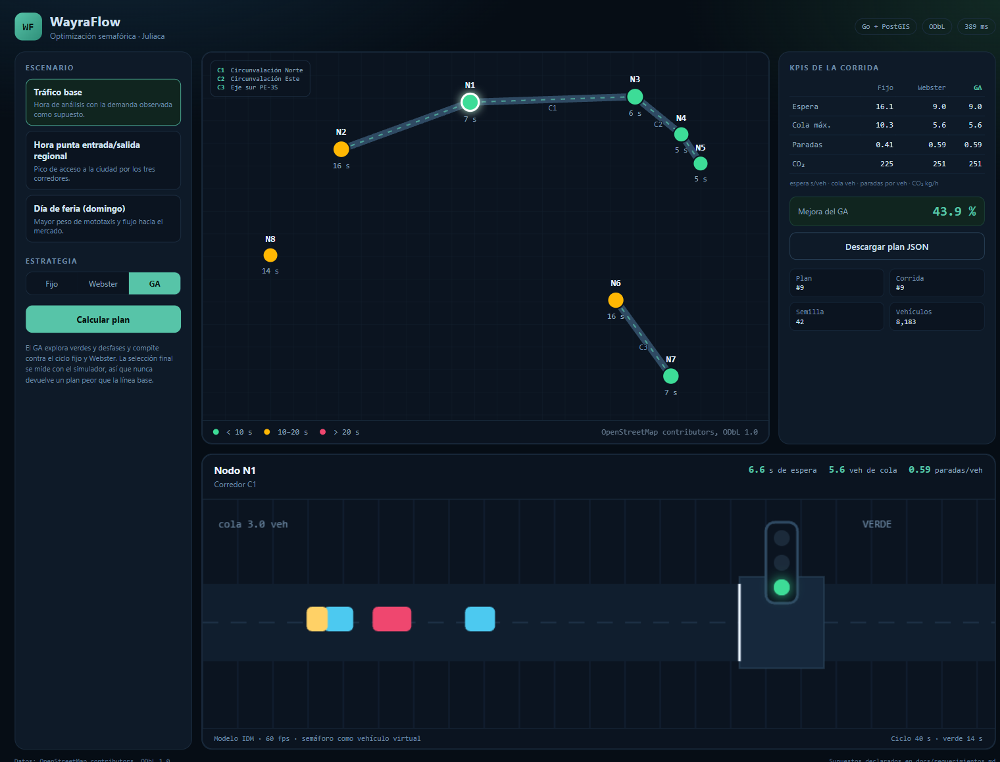

# WayraFlow

## 1. Resumen

WayraFlow es una plataforma web (Angular + Go + PostgreSQL/PostGIS) de optimización semafórica a escala de ciudad para Juliaca (San Román, Puno, Perú).
Compara los planes de ciclo fijo actuales con planes optimizados por un algoritmo genético (verdes por intersección y desfases por corredor).
Está dirigida a gestores municipales de tránsito y a evaluadores técnicos.
Demuestra que un plan de tiempos exportable, sin hardware nuevo, puede reducir espera, colas y CO₂ en los semáforos existentes.



## 1.1 Cómo ejecutar

Requisitos: Docker 24+ para el stack completo; Go 1.23+ y Node 22+ para
desarrollo sin contenedores.

### Todo con Docker

```bash
cp .env.example .env
docker compose up --build
```

- Tablero: <http://localhost:4200>
- API: <http://localhost:8080/api/v1/scenarios>
- Salud: <http://localhost:8080/health>

### Sin base de datos (demo rápida)

```bash
cd backend
go run ./cmd/api
```

Sin `DATABASE_URL` la API usa el catálogo en memoria: los mismos escenarios,
planes y KPIs, sin PostGIS. El healthcheck responde igual y los planes se
pierden al reiniciar.

### Desarrollo del frontend

```bash
cd frontend
npm ci
npm start
```

`ng serve` reenvía `/api` a `http://localhost:8080` según `proxy.conf.json`.

### Pruebas

```bash
cd backend
go test ./...
go run ./cmd/bench
```

`cmd/bench` imprime la comparación de las tres estrategias en cada escenario y
es la evidencia de los números que se citan en la sección 7.

## 2. Problema urbano

| Hecho | Fuente |
|---|---|
| Juliaca está a 3 824 m s. n. m. y es la ciudad con mayor población del departamento de Puno; predomina la actividad comercial e industrial | [IGP][igp] |
| Mayor centro económico del departamento; conecta por carretera y ferrocarril con Puno, Cusco, Arequipa, Tacna y Bolivia | [MPSR, Geografía y clima][mpsr-geo] |
| La Ordenanza Municipal N.° 001-2025-MPSR-J "declara y regula las vías saturadas por congestión vehicular y contaminación sonora"; los vehículos interprovinciales, interdepartamentales y de carga pesada deben bordear la Av. Circunvalación | [MPSR, gob.pe][mpsr-ord] |
| Un estudio de 16 intersecciones del centro encontró inicialmente cuatro con nivel de servicio bajo (E y D) | [Marca y Ramos, UPeU 2024][upeu] |
| Existe una "feria dominical" de alcance local | [Radio Onda Azul][feria] |

Mezcla vehicular (categorías según el Reglamento Nacional de Vehículos y la [Directiva 002-2006-MTC/15][mtc-dir]):

| Clase | Categoría MTC | Definición (cita textual) |
|---|---|---|
| Mototaxi | L5 | "Vehículos de tres ruedas simétricas al eje longitudinal del vehículo, de más de 50 cm3 o velocidad mayor a 50 km/h y cuyo peso bruto vehicular no exceda de una tonelada." El servicio de mototaxi "deberá ser de la categoría L5" ([DS 058-2003-MTC][rnv]) |
| Combi / cúster | M2 (M3 si el PBV supera 5 t) | M2: "Vehículos de más de 8 asientos sin contar el asiento del conductor y peso bruto vehicular de 5 toneladas o menos." |
| Auto | M1 | Vehículo de pasajeros liviano |
| Carga pesada | N2 / N3 | Vehículos de mercancías |

No existe una composición vehicular pública para Juliaca, así que los porcentajes de la sección 6 son `Supuesto`.

## 3. Red vial y nodos críticos

### 3.1 Extracción (Overpass API, consultada el 2026-11-27)

```
[out:json][timeout:120];
way["highway"~"^(trunk|primary|secondary|tertiary)(_link)?$"](-15.56,-70.20,-15.44,-70.08);
out body; >; out skel qt;
node["highway"="traffic_signals"](-15.56,-70.20,-15.44,-70.08);
out body;
```

Resultado en esa caja: 566 vías (71 `trunk`, 49 `primary`, 76 `secondary`, 352 `tertiary`, 18 `*_link`).
OSM etiqueta las vías nacionales PE-3S, PE-34A y PE-34H como `trunk`, así que se incluyen junto a las primarias.

### 3.2 Semáforos mapeados

- Hay 77 nodos `highway=traffic_signals`. OSM suele mapear un nodo por acceso, así que se agrupan los que están a menos de 70 m, lo que da unas 45 intersecciones semaforizadas.
- La mayoría están en el damero central (jirones Mariano Núñez, Huancané, 2 de Mayo, Jáuregui y San Román) y en tres anillos: Circunvalación, Autopista Mártires del 4 de Noviembre y Av. Independencia.
- La cobertura de OSM no está auditada en campo. Para no depender de ella, uno de los nodos críticos es un cruce principal sin semáforo mapeado; ver la columna "Semáforo OSM".

### 3.3 Nodos críticos

Los cruces están confirmados por un nodo OSM compartido entre las vías nombradas.

| ID | Intersección (nombres OSM) | Nodo OSM | Semáforo OSM | Justificación |
|---|---|---|---|---|
| N1 | Av. Circunvalación Norte × Av. Independencia (PE-3S) | 257687118 | Sí | Salida a Cusco; el ramal `Bypass Salida a Cusco` llega aquí |
| N2 | Av. Circunvalación Norte (PE-34A) × Av. Ferrocarril | 1282294742 | Sí | Une el anillo con la vía primaria al centro |
| N3 | Av. Circunvalación Norte × Av. Circunvalación Este × Av. Triunfo | 1281999136 | Sí | Cambio de tramo del anillo PE-3S |
| N4 | Av. Circunvalación Este (PE-3S) × Av. Huancané (PE-34H) | 257687482 | Sí | Salida a Huancané |
| N5 | Av. Circunvalación Este × Jr. Huancané | 443135956 | No en el nodo; semáforo 443135960 a ~90 m | Acceso al Mercado Internacional Túpac Amaru, a ~320 m según las coordenadas de [Wikipedia][tupac] |
| N6 | Autopista Mártires del 4 de Noviembre (PE-3S) × Av. Tacna × Jr. Manuel Núñez Butrón | grupo 2420987313 | Sí | Acceso sur por PE-3S, salida a Puno |
| N7 | Autopista Mártires del 4 de Noviembre × Av. Américas × Jr. José Domingo Choquehuanca | grupo 3226623702 | Sí | Segundo semáforo del eje sur |
| N8 | Av. Circunvalación Oeste (PE-34A) × Héroes del Pacífico | 255459726 | No | Acceso oeste por PE-34A, salida a Arequipa (ver pendientes) |

### 3.4 Corredores coordinables

Las distancias son en línea recta entre nodos, calculadas desde el GeoJSON.

| Corredor | Nodos | Distancias (m) | Onda verde |
|---|---|---|---|
| C1 Circunvalación Norte | N2 → N1 → N3 | 941, 955 | Bidireccional, priorizando el sentido oeste→este (`Supuesto`) |
| C2 Circunvalación Este | N3 → N4 → N5 | 532, 374 | Norte→sur, hacia el mercado |
| C3 Eje sur PE-3S | N6 → N7 | 984 | Sur→norte en la mañana y al revés en la tarde |

N8 se optimiza en forma aislada, solo con sus verdes y sin offset.

## 4. Arquitectura del MVP

### 4.1 Stack

| Pieza | Elección | Justificación |
|---|---|---|
| Frontend | Angular + TypeScript | Estructura por componentes y servicios para las vistas ciudad y nodo |
| Mapa | MapLibre GL JS | Renderizado WebGL de GeoJSON y estilos por dato sin clave de API |
| Vista nodo | Canvas 2D (en el navegador) | La micro-simulación IDM anima cientos de vehículos a 60 fps sin viajes al servidor |
| Backend | Go (API HTTP/JSON) | Modelo de ciudad, algoritmo genético, Webster, emisiones, KPIs y exportación; cómputo rápido y concurrente |
| Base de datos | PostgreSQL + PostGIS | Red vial, nodos y corredores como geometrías; escenarios, planes y corridas con sus KPIs |
| Ejecución | Docker Compose | Un solo `docker compose up` levanta base de datos y backend; el frontend se suma cuando exista el workspace Angular |

Reparto: Go calcula y persiste; Angular visualiza y ejecuta solo la micro-simulación de la vista nodo.

### 4.2 Datos

- La red se extrae una sola vez con la consulta de 3.1, se guarda como `data/juliaca.geojson` en el repositorio y se carga en PostGIS al iniciar. La demo no depende de internet: el mapa base no usa teselas externas.
- Licencia: © colaboradores de OpenStreetMap, bajo [ODbL 1.0][odbl]. La atribución sigue [osm.org/copyright][osmcopy] y aparece visible en el mapa.

### 4.3 Modelo de ciudad (mesoscópico)

- Cada acceso de cada nodo es una cola puntual. Las llegadas son demanda `q` en veh/h, convertida a vehículos equivalentes con un factor por clase (`Supuesto`).
- Durante el verde efectivo la cola se descarga a flujo de saturación `s`, con 1 800 veh-eq/h/carril como `Supuesto`.
- Los arcos entre nodos de un corredor propagan pelotones con retardo `L/v_libre`. Si la cola supera la capacidad de almacenamiento del arco, bloquea el nodo aguas arriba (spillback o gridlock).
- Paso de 1 s y horizonte de 3 600 s. Se simulan todos los nodos a la vez.

### 4.4 Modelo de nodo (microscópico, IDM)

Aceleración IDM ([Treiber, Hennecke y Helbing, 2000][idm]):

$$\dot v = a\left[1-\left(\frac{v}{v_0}\right)^{\delta}-\left(\frac{s^*(v,\Delta v)}{s}\right)^2\right],\quad s^* = s_0 + vT + \frac{v\,\Delta v}{2\sqrt{ab}},\ \delta=4$$

| Tipo | l (m) | v₀ (km/h) | T (s) | s₀ (m) | a (m/s²) | b (m/s²) | Origen |
|---|---|---|---|---|---|---|---|
| Auto (M1) | 5 | 50 | 1,0 | 2 | 2,0 | 2,0 | l: [Treiber 2000][idm]; resto: "Cars City" en [Treiber, Lecture 09][idm-city] |
| Pesado (M2/M3/N) | 10 | 50 | 1,8 | 3 | 0,5 | 1,0 | T, s₀, a, b: "Trucks Hwy" en [Lecture 09][idm-city]; l y v₀ urbana son `Supuesto` |
| Mototaxi (L5) | 3 | 35 | 1,0 | 1,5 | 1,0 | 1,5 | Todo `Supuesto`, a calibrar con video |

El semáforo aparece como un vehículo virtual detenido en la línea de pare durante el rojo y el ámbar tardío.

### 4.5 Optimizador (algoritmo genético)

- **Cromosoma**: `[C_c | g_{n,p} | θ_n]`.
  - `C_c` es el ciclo común de cada corredor, entre 40 y 120 s.
  - `g_{n,p}` es la fracción de verde por fase de cada nodo, reparada para que `Σg + L_n = C`.
  - `θ_n` es el offset de cada nodo respecto del primero de su corredor, entre 0 y `C_c`.
- **Operadores**: torneo (k = 3), cruce BLX-α (α = 0,3), mutación gaussiana (σ = 5 % del rango), elitismo de 2 individuos y reparación de verdes mínimos (`Supuesto`: 7 s).
- **Parámetros**: población de 60 y 150 generaciones como máximo, con corte por presupuesto de 3 s en el backend. Son parámetros de diseño a ajustar con benchmark.
- **Aptitud** (a minimizar):

$$J = \sum_{n}\sum_{k} w_k\,D_{n,k} \;+\; \lambda_g \sum_{(n\to m)} \max\left(0,\ \ell^{\max}_{n\to m}-S_{n\to m}\right) \;+\; \lambda_e\, E_{\mathrm{CO_2}}$$

`D_{n,k}` es la espera total (veh·s) de la clase `k` en el nodo `n`, y `w_k` su peso; con ocupación promedio como `Supuesto`, el M2 pesa más que el M1.
`ℓ^max` es la cola máxima en metros y `S` el almacenamiento del arco hacia el nodo vecino.
`E_CO₂` sale de la sección 5. `λ_g` y `λ_e` se fijan en la configuración.

### 4.6 Líneas base

- **Ciclo fijo**: el plan actual, que no es público, se representa con un ciclo uniforme de 90 s y verdes iguales (`Supuesto`).
- **Webster**: ciclo óptimo `C₀ = (1,5 L + 5) / (1 − Y)`, con `L` el tiempo perdido por ciclo y `Y` la suma de las razones críticas `y_i = q_i/s_i` ([FHWA, cap. 6][fhwa]). Los verdes se reparten de forma proporcional a `y_i` ([Webster, 1958][webster]).

## 5. Modelo de emisiones

1. **Ralentí**: un sedán compacto de 2,0 L consume 0,16–0,17 gal/h (≈0,61–0,64 L/h); un bus urbano, cerca de 1 gal/h (≈3,8 L/h) ([ORNL, FOTW #861][ornl]).
   - Se usa 0,6 L/h para M1, 3,8 L/h para Pesado y 0,3 L/h para L5 (este último `Supuesto`).
2. **Arranques**: combustible extra por parada y clase como `Supuesto`: L5 5 mL, M1 10 mL, Pesado 40 mL. Se reemplaza al calibrar.
3. **CO₂**: gasolina 8 887 g/gal (≈2,35 kg/L) y diésel 10 180 g/gal (≈2,69 kg/L) ([EPA][epa]). Esto es consistente con los factores por defecto de [IPCC 2006][ipcc]: 69 300 y 74 100 kg/TJ.
   - Combustible por clase (`Supuesto`): L5 y M1 a gasolina; Pesado a diésel.
4. **Altitud**: el factor de CO₂ por litro depende del carbono del combustible ([EPA][epa]), no de la altitud. Que a 3 824 m aumenten el CO y los HC por combustión incompleta es una hipótesis técnica sin fuente verificada en este documento (ver pendientes).
   - WayraFlow no modela CO ni HC. No se aplica ningún factor de altitud; si se agrega, irá marcado como `Supuesto`.

## 6. Escenarios predefinidos

Todos los valores son `Supuesto`, porque no hay aforos vehiculares públicos. La demanda está en veh/h por sentido principal en la hora de análisis.

| Escenario | C1 Circ. Norte | C2 Circ. Este | C3 Eje sur | N8 | Mezcla L5 / M1 / M2 / N |
|---|---|---|---|---|---|
| Tráfico base | 700 | 600 | 650 | 400 | 35 / 35 / 20 / 10 % |
| Hora punta entrada/salida regional | 1 000 | 750 | 1 000 | 650 | 25 / 30 / 30 / 15 % |
| Día de feria (domingo) | 850 | 1 050 | 800 | 450 | 45 / 25 / 20 / 10 % |

Los giros se fijan en 70 % de paso, 15 % a la izquierda y 15 % a la derecha, también como `Supuesto`.

## 7. KPIs

Cada KPI se calcula por nodo y para la ciudad, en ciclo fijo, Webster y algoritmo genético.

| KPI | Unidad | Cálculo por nodo | Agregado ciudad |
|---|---|---|---|
| Espera promedio | s/veh | `Σ espera / vehículos servidos`; en micro, tiempo con v < 0,5 m/s | Promedio ponderado por vehículos |
| Cola máxima | veh y m | Máximo de la cola en el horizonte; m = Σ (l_k + s₀,k) | Máximo y suma |
| Paradas por vehículo | — | Llegadas en rojo o con cola / vehículos; en micro, transiciones a v < 0,5 m/s | Ponderado por vehículos |
| CO₂ | kg/h | Sección 5: (ralentí + arranques) × factor | Suma |
| Mejora | % | `(KPI_fijo − KPI_plan) / KPI_fijo × 100` | Igual, sobre el agregado |

## 8. Plan semafórico exportable

Ejemplo abreviado de esquema JSON. Es un formato propio de WayraFlow: no garantiza compatibilidad con ningún controlador.

```json
{
  "schema": "wayraflow.plan/v1",
  "city": "Juliaca",
  "scenario": "hora-punta-regional",
  "generatedAt": "2026-11-27T00:00:00Z",
  "source": "OpenStreetMap contributors, ODbL 1.0",
  "corridors": [
    { "id": "C1", "cycle_s": 90, "offsets_s": { "N2": 0, "N1": 34, "N3": 68 } }
  ],
  "nodes": [
    {
      "id": "N1", "osmNode": 257687118, "corridor": "C1", "cycle_s": 90,
      "phases": [
        { "id": 1, "movements": ["Circ. Norte E-O"], "green_s": 38, "amber_s": 3, "allRed_s": 2 },
        { "id": 2, "movements": ["Independencia N-S"], "green_s": 42, "amber_s": 3, "allRed_s": 2 }
      ]
    }
  ],
  "kpis": { "avgDelay_s": { "fixed": 0, "plan": 0 }, "co2_kg_h": { "fixed": 0, "plan": 0 } }
}
```

Validación: en cada nodo se cumple `Σ(green + amber + allRed) = cycle_s`, y en cada corredor `0 ≤ offset < cycle_s`.

## 9. Fuera de alcance, supuestos y limitaciones

**Fuera de alcance**
- SUMO, control adaptativo en tiempo real e integración con controladores.
- Peatones, ciclistas, prioridad de transporte público y vehículos de emergencia.
- Modelado de CO, HC y NOx.

**Supuestos y limitaciones**
- No hay aforos vehiculares públicos ni planes semafóricos vigentes publicados. La demanda, la mezcla y el ciclo fijo son `Supuesto`.
- La cobertura de semáforos en OSM no está validada en campo.
- Los parámetros IDM de L5 y los de consumo por arranque no tienen fuente local.
- La mejora en % compara modelos entre sí; no es una medición en calle.

## 10. Hoja de ruta

| Hito | Alcance | Criterio de aceptación | Commit sugerido |
|---|---|---|---|
| 1 | Red de la ciudad + vista nodo | La red se carga en PostGIS y la API la sirve; el mapa funciona sin internet, muestra los 8 nodos y los 3 corredores con su atribución ODbL, y al seleccionar un nodo se abre la micro-simulación IDM con los 3 tipos de vehículo y temporizador | `feat(map): add Juliaca OSM network and IDM node view` |
| 2 | Optimizador + escenarios | Se pueden elegir los 3 escenarios. El algoritmo genético termina en menos de 3 s en el backend Go y mejora J frente al ciclo fijo; Webster queda disponible como referencia | `feat(optimizer): add genetic signal optimizer and city scenarios` |
| 3 | KPIs + exportación | Hay KPIs por nodo y por ciudad para las 3 estrategias. El JSON exportado cumple las validaciones de la sección 8 | `feat(kpi): add city KPIs and signal plan export` |

## 11. Referencias

- IGP, "El clima en el Perú: Juliaca": [met.igp.gob.pe][igp]
- Municipalidad Provincial de San Román, "Geografía y clima": [munijuliaca.pe][mpsr-geo]
- Municipalidad Provincial de San Román, desvío por Av. Circunvalación (Ordenanza 001-2025-MPSR-J), 2025: [gob.pe][mpsr-ord]
- MTC, DS 058-2003-MTC, Reglamento Nacional de Vehículos: [mtc.gob.pe][rnv]
- MTC, Directiva 002-2006-MTC/15, Clasificación vehicular: [gob.pe][mtc-dir]
- Marca Flores y Ramos Apaza (2024), *Gestión del transporte mediante PTV Vissim en el centro de la ciudad de Juliaca, 2023*, UPeU: [repositorio][upeu]
- Radio Onda Azul (2021), feria dominical de Juliaca: [radioondaazul.com][feria]
- Wikipedia, Mercado Internacional Túpac Amaru (coordenadas): [es.wikipedia.org][tupac]
- OpenStreetMap, Copyright and License: [osm.org/copyright][osmcopy]; ODbL 1.0: [opendatacommons.org][odbl]
- Treiber, Hennecke y Helbing (2000), *Phys. Rev. E* 62, 1805: [arXiv cond-mat/0002177][idm]
- Treiber, *Lecture 09: Car-Following Models Based on Driving Strategies*: [mtreiber.de][idm-city]
- Webster, F. V. (1958), *Traffic Signal Settings*, Road Research Technical Paper 39, HMSO: [WorldCat][webster]
- FHWA (2008), *Traffic Signal Timing Manual*, cap. 6: [ops.fhwa.dot.gov][fhwa]
- ORNL, Fact of the Week #861, idle fuel consumption: [tedb.ornl.gov][ornl]
- US EPA, *Greenhouse Gas Emissions from a Typical Passenger Vehicle*: [epa.gov][epa]
- IPCC (2006), *Guidelines*, Vol. 2, cap. 3, Mobile Combustion: [ipcc-nggip.iges.or.jp][ipcc]

## Pendiente de verificar

- Que la PE-34A en el nodo N8 sea la salida a Arequipa. La relación de ruta en OSM no se pudo consultar porque Overpass estaba saturado.
- El reparto de verdes proporcional a `y_i` en el texto original de Webster (el PDF es escaneado): https://www.sinaldetransito.com.br/artigos/traffic_signals_webster.pdf
- Una fuente académica sobre el efecto de la altitud en CO/HC; no cargaron https://www.mdpi.com/2073-4433/14/12/1739 ni https://pmc.ncbi.nlm.nih.gov/articles/PMC11582403/
- La población oficial de Juliaca (INEI, Censo 2017): https://www.inei.gob.pe/media/MenuRecursivo/publicaciones_digitales/Est/Lib1563/
- Tesis UANCV sobre el cruce Av. Jorge Chávez × Av. Ferrocarril (no abierta): https://repositorio.uancv.edu.pe/items/ec6344fd-dfdf-4af1-bb07-d8fef5c2a0d1/full

[igp]: http://met.igp.gob.pe/clima/HTML/juliaca.html
[mpsr-geo]: https://munijuliaca.pe/pagina/geografia-y-clima/4/
[mpsr-ord]: https://www.gob.pe/institucion/munisanroman/noticias/1186075-socializamos-el-desvio-de-rutas-para-los-vehiculos-interprovinciales-e-interdepartamentales-quienes-deberan-bordear-la-av-circunvalacion
[rnv]: https://www.mtc.gob.pe/cnsv/documentos/normas-legales/DS%20058-2003-MTC.pdf
[mtc-dir]: https://www.gob.pe/institucion/mtc/normas-legales/282132-002-2006-mtc-15
[upeu]: https://repositorio.upeu.edu.pe/items/f55c2c00-4b27-4dfd-af93-c45ef36021ff/full
[feria]: https://radioondaazul.com/juliaca-informan-que-feria-dominical-se-desarrollara-con-normalidad/
[tupac]: https://es.wikipedia.org/wiki/Mercado_Internacional_T%C3%BApac_Amaru
[osmcopy]: https://www.openstreetmap.org/copyright
[odbl]: https://opendatacommons.org/licenses/odbl/1-0/
[idm]: https://arxiv.org/abs/cond-mat/0002177
[idm-city]: https://www.mtreiber.de/Vkmod_Skript/Lecture09_Micro2_talk.pdf
[webster]: https://search.worldcat.org/title/Traffic-signal-settings/oclc/22744886
[fhwa]: https://ops.fhwa.dot.gov/publications/fhwahop08024/chapter6.htm
[ornl]: https://tedb.ornl.gov/fotw/861/
[epa]: https://www.epa.gov/greenvehicles/greenhouse-gas-emissions-typical-passenger-vehicle
[ipcc]: https://www.ipcc-nggip.iges.or.jp/public/2006gl/pdf/2_Volume2/V2_3_Ch3_Mobile_Combustion.pdf
