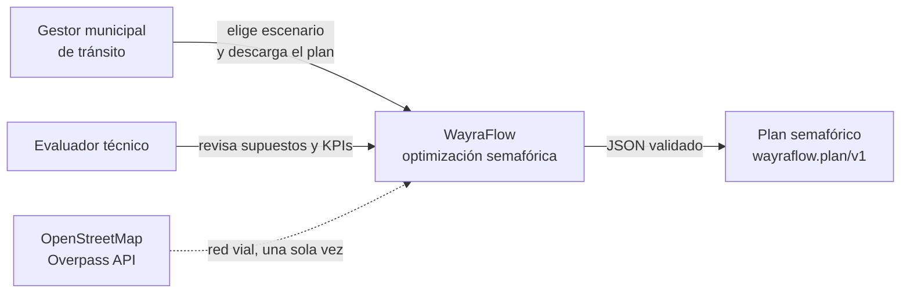
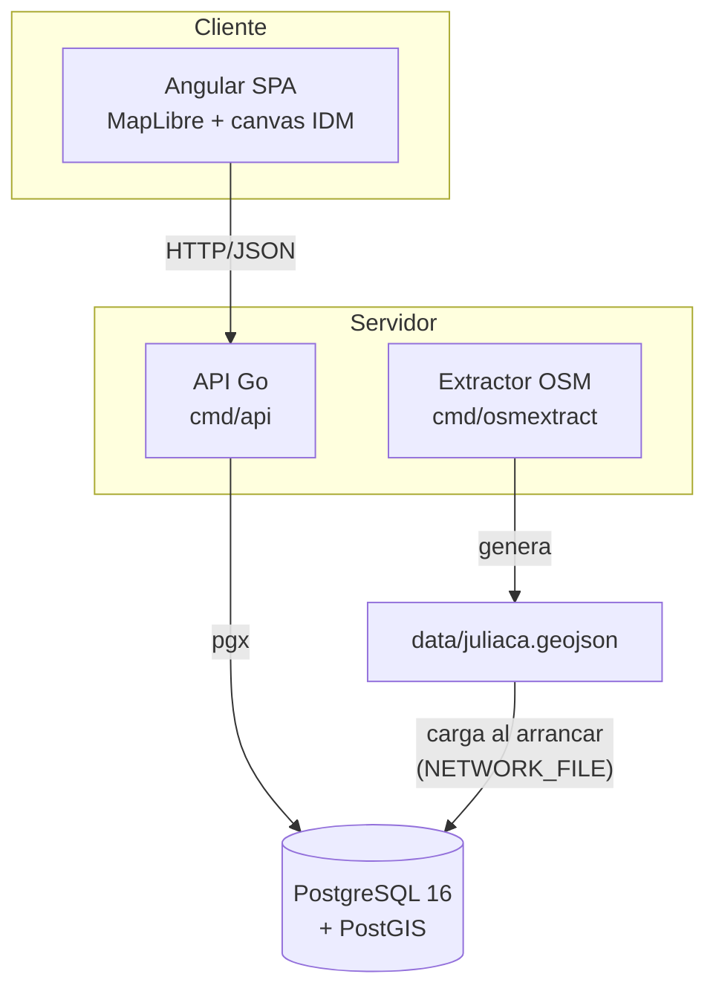
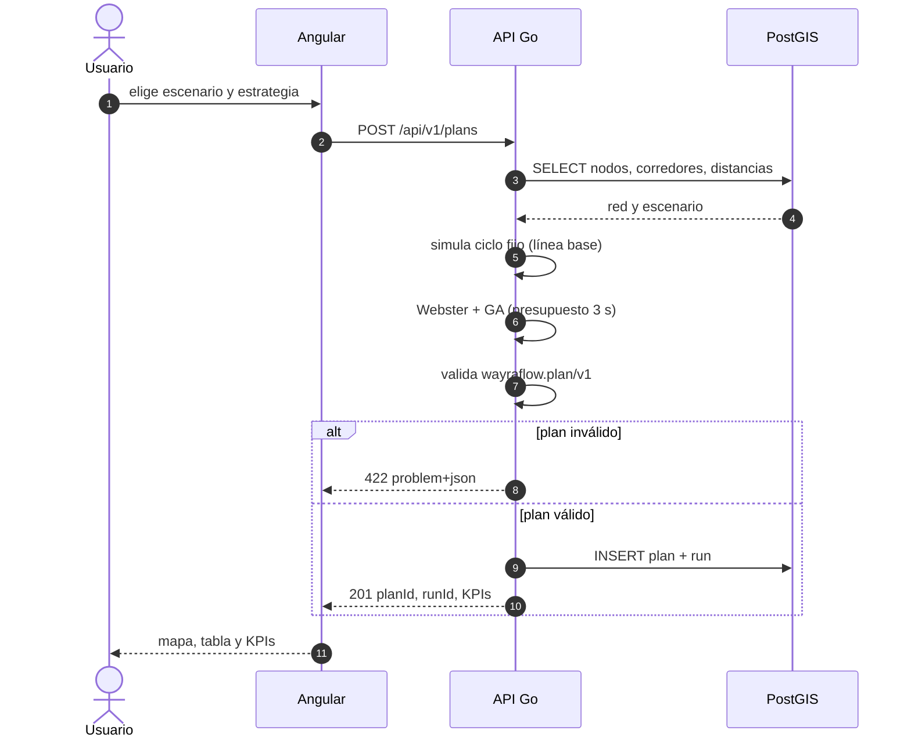
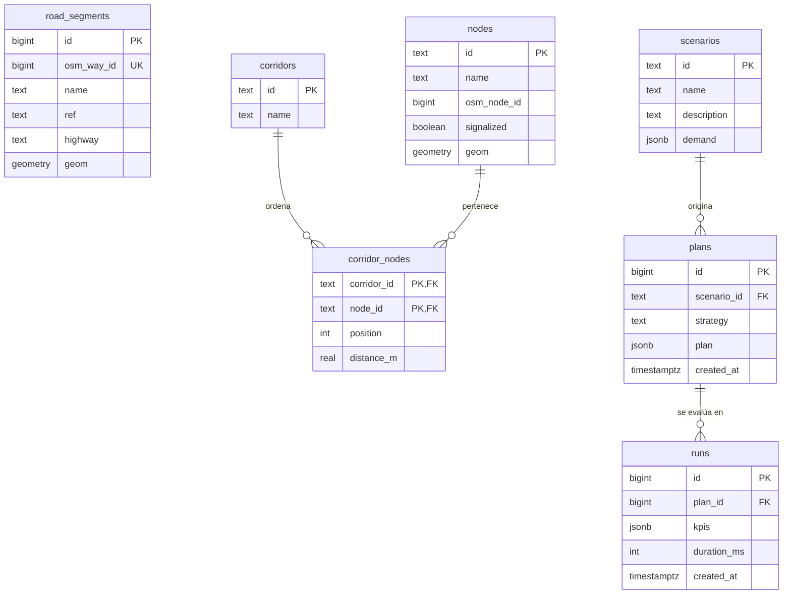

# Diagramas

Los diagramas viven en el repositorio como texto Mermaid: GitHub los renderiza,
se versionan con el código y no se desactualizan como un PNG.

## 1. Contexto (C4 nivel 1)

Quién usa el sistema y de qué depende.

La línea punteada es una dependencia que se resuelve una vez: la red se extrae y
se versiona. En operación, el sistema no consulta Overpass.

## 2. Contenedores (C4 nivel 2)

Qué corre y dónde.

Implementado hoy: la API, las migraciones, la semilla de nodos y corredores, la
carga del GeoJSON y el extractor. Pendiente: la SPA.

## 3. Secuencia de una corrida

El camino de un `POST /api/v1/plans` hasta el plan validado. Es el contrato
objetivo: los endpoints todavía no existen.

## 4. Modelo de datos

Las siete tablas del esquema y sus relaciones.

`road_segments` no se relaciona por clave foránea con `corridors`: la pertenencia
geográfica se resuelve por intersección de geometrías, no por integridad
referencial. Es una decisión consciente, no un olvido.
